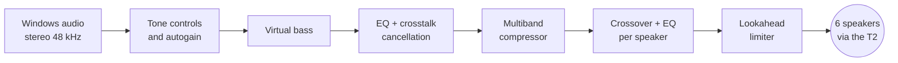

<p align="center">
  
</p>

<p align="center">
  <a href="https://github.com/imacorpoliz/t2audiowindows/actions/workflows/build.yml"></a>
  
  
  
  
  
</p>

<p align="center">
  <b>A Windows audio driver for the MacBook Pro 16" (2019) with the Apple T2 chip</b><br>
  an alternative to Apple's Boot Camp driver, with the speaker sound of the Linux project <a href="https://github.com/kaiT2en/KaiT2en-Fedora">KAIT2EN</a>
</p>

<p align="center">
  <a href="docs/GUIDE.md">🚀 Install guide</a> ·
  <a href="docs/INSTALL.md">📖 Reference</a> ·
  <a href="docs/ROADMAP.md">🗺️ Roadmap</a> ·
  <a href="docs/CURRENT_STATE.md">📋 Changelog &amp; tests</a>
</p>

---

> [!NOTE]
> **Verified on hardware.** Everything marked ✅ was tested and confirmed on a physical MacBookPro16,1 under Windows 11 Pro build 28000.

## ✨ What works

| | Feature | Since | Notes |
|:-:|---|:-:|---|
| ✅ | 🔊 **Six speakers**, stereo 48 kHz | 1.0.8 | KAIT2EN 16_1 processing: EQ per speaker, crosstalk cancellation, virtual bass, multiband compressor, limiter |
| ✅ | 🎚️ **Presets and tone** | 1.0.12 | 13 presets, bass / treble / clarity ±12 dB; `macos` is the owner-approved default |
| ✅ | 🛡️ **Starts with Windows**, crash guard | 1.0.12 | Two unclean ends in a row and the driver steps aside until you reset it (`CrashGuardStrikes = 0`) |
| ✅ | 🎧 **Headphones** (3.5 mm) | 1.0.13 | Separate output endpoint, −12 dB safety cut |
| ✅ | 🔄 **Auto headphone ↔ speaker switching** | 1.0.13.8 | Dynamic jack presence detection via `KSPROPERTY_JACK_DESCRIPTION2`, automatic audio routing on plug/unplug |
| ✅ | 🎙️ **Built-in microphones** | 1.0.13.4 | 3-mic array capture, KAIT2EN beamforming + high-pass DSP |
| ✅ | 🌙 **Sleep and wake** | 1.0.13 | Playback continues cleanly after sleep/wake |
| ✅ | 🎛️ **16/24-bit** for exclusive-mode apps | 1.0.13 | Shared mode stays 32-bit |

## 📐 Architecture & Implementation Details

| Component | Status | Implementation Details |
|---|:---:|---|
| **Volume & Mute** | **Verified (Software)** | Apple T2 DACs operate at fixed unity gain (`docs/analysis/RE_volume.md`). Official Apple drivers contain zero hardware volume nodes; volume attenuation is 100% software-based in Windows Audio Engine and host DSP with lookahead limiting. |
| **Sample Rates (44.1 / 96 / 192 kHz)** | **Verified (Transparent)** | The T2 hardware audio clock is locked to 48,000.0 Hz (`docs/analysis/RE_sample_rate.md`). All non-48 kHz formats are transparently and losslessly resampled by Windows Audio Engine in shared mode. |
| **Headset Microphone (3.5 mm TRRS)** | **Documented Architecture** | The built-in 3-microphone studio array is active and used by default. External TRRS headset mic ("Codec Input" 0x44) protocol is documented in `docs/analysis/RE_headset_mic.md`. |
| **Other T2 Macs** | **Profiles Ready** | KAIT2EN DSP filter profiles exist for 12 T2 models in `tools/dsp/gen_kait2en_dsp.py`. Community testers on specific physical models welcome. |
| **Microsoft signature** | **Test-signed** | Driver package is test-signed (requires test mode enabled and Secure Boot off). |

## 🚀 Quick start

```powershell
# PowerShell as Administrator, in the unpacked release folder
.\tools\T2Audio-Setup.ps1 -Action Prepare                        # once: test mode, then reboot
.\tools\T2Audio-Setup.ps1 -Action Install -Preset macos
.\tools\T2Audio-Setup.ps1 -Action Features -Headphones 1 -Microphone 1 -ResumeAfterSleep 1
```

Step by step, including turning Secure Boot off on the Mac: **[docs/GUIDE.md](docs/GUIDE.md)**. Back to Apple's driver at any time: `-Action Uninstall`.

## 🎛️ How the sound is made



Everything runs inside the driver, in fixed point, about 50 µs per 2 ms of audio (< 0.5% CPU load).

## 🙏 Where everything comes from

| Part | Source |
|---|---|
| T2 protocol, buffer layout, speaker layout, clock | Linux driver `modules/t2bce_audio` of [KAIT2EN](https://github.com/kaiT2en/KaiT2en-Fedora) (earlier [linux-t2](https://github.com/kekrby/linux-t2)) — our Windows code is new, the knowledge is theirs |
| Speaker and microphone sound | KAIT2EN `dsp/profiles/16_1`, converted by `tools/dsp/gen_kait2en_dsp.py`; the fixed-point engine is ours |
| Virtual bass | [bankstown](https://github.com/chadmed/bankstown) (MIT), re-implemented in fixed point |
| Compressor / autogain options | modelled on [lsp-plugins](https://lsp-plug.in/) defaults as used by KAIT2EN (no lsp code) |
| Windows-specific behaviour | reverse engineering of Apple's `AppleAudio.sys` / `AppleUSBVHCI.sys` for interoperability ([`docs/analysis/`](docs/analysis/)) |
| The work itself | code by Claude (Anthropic), builds and hardware tests by Gemini (Google) on the owner's Mac, every decision and listening verdict by the owner |

Full credits: [THIRD_PARTY_LICENSES.md](THIRD_PARTY_LICENSES.md).

## ⚖️ Licence

**GPL-3.0-or-later** ([LICENSE](LICENSE)), because the driver contains DSP tables derived from KAIT2EN's GPL-3.0-or-later profile. Its attribution term (GPL-3.0 §7b) applies: *speaker and microphone DSP from the KAIT2EN 16_1 profile, Copyright (C) 2026 André Eikmeyer*. Virtual bass after bankstown, MIT, Copyright (C) 2023 James Calligeros.

## 🛠️ For developers

* [docs/DRIVER_GUIDE.md](docs/DRIVER_GUIDE.md) — architecture, every registry parameter, log lines
* [docs/ROADMAP.md](docs/ROADMAP.md) — what is left · [GEMINI.md](GEMINI.md) — build, signing, hardware test procedures
* Build: Visual Studio 2022 + WDK, `msbuild src\T2AudioMiniport.vcxproj /p:Configuration=Release /p:Platform=x64`
* Tests: `tests\*.c` with any C compiler (`-lm`); CI builds the driver and runs all tests on every push
