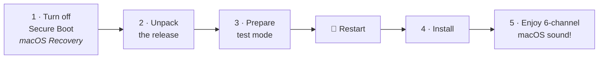

# 🚀 T2AudioPort — Step-by-Step Install Guide

For: **MacBook Pro 16" (2019), model `MacBookPro16,1`**, running Windows 10/11 x64 through Boot Camp.  
Time: about 10–15 minutes, one restart. You can return to Apple's driver at any point.



> [!IMPORTANT]
> T2AudioPort is **test-signed** (self-signed driver certificate). Windows only loads self-signed drivers in **test mode**, which requires **Secure Boot off** in macOS Startup Security Utility. Windows displays a small "Test Mode" watermark in the corner of your desktop while active.

---

## 0. Before you start

| Check | How |
|---|---|
| ✅ **Hardware Model:** MacBookPro16,1 | Windows: `Win + R` → type `msinfo32` → check "System Model" |
| ✅ **Boot Camp:** Windows is running | Boot Camp drivers installed and functioning |
| ✅ **Admin Password:** macOS credentials | Needed to change Secure Boot in Recovery |
| ✅ **BitLocker:** Recovery key handy | `manage-bde -status C:` (installer can suspend for 1 reboot) |

---

## 1. Turn off Secure Boot (on the Mac, once)

1. Restart your Mac and hold **⌘ Command + R** (or **Win + R**) until the Apple logo appears to enter **macOS Recovery**.
2. In the top menu bar, click **Utilities → Startup Security Utility**, and sign in with your macOS administrator password.
3. Select **Secure Boot: No Security**. Leave "Allowed Boot Media" as-is.
4. Restart back into Windows (hold **⌥ Option / Alt** at startup and select "Boot Camp" / "Windows").

---

## 2. Unpack the release

1. Download `T2AudioPort-1.0.13.20.zip` from [Releases](https://github.com/imacorpoliz/t2audiowindows/releases).
2. Unpack the zip file to a clean folder, e.g. `C:\T2AudioPort`.
3. Open **PowerShell as Administrator** (Start → search `powershell` → right-click → *Run as administrator*) and run:

```powershell
cd C:\T2AudioPort
Get-ChildItem -Recurse | Unblock-File
Set-ExecutionPolicy -Scope Process Bypass -Force
```

---

## 3. Prepare Windows (test mode, once)

```powershell
.\tools\T2Audio-Setup.ps1 -Action Prepare
```

What you will see:
* `✓ Secure Boot: off`
* Confirmation prompt: **"Turn test mode on? [y/n]"** → press `y`.
* If BitLocker is detected: **"Suspend BitLocker for one reboot?"** → press `y`.
* `✓ Test mode on. Reboot Windows...`

**🔄 Restart Windows now.** After reboot, you will see "Test Mode" in the bottom-right corner of your desktop.

---

## 4. Install the driver

Open **PowerShell as Administrator** again:

```powershell
cd C:\T2AudioPort
Set-ExecutionPolicy -Scope Process Bypass -Force
.\tools\T2Audio-Setup.ps1 -Action Install -Preset macos
```

1. **"Trust this test certificate on this computer? [y/n]"** → press `y` (installs the public certificate into the trusted store).
2. Type **`INSTALL`** when prompted.
3. Wait ~15 seconds while the driver registers. Success output:

```
   ✓ Persistent mode on, crash guard reset.
   ✓ T2AudioPort is installed and running.
   ✓ T2 speakers: unmuted, volume 30 %, 6-channel DSP active.
```

---

## 5. What works right away

Everything is active and automated out of the box:
- 🔊 **6 Physical Speakers:** 4 force-cancelling woofers + 2 tweeters driven simultaneously with macOS-grade tuning and virtual sub-bass.
- 🔄 **Automatic Headphone Switching:** Plug your 3.5 mm headphones in and playback automatically transfers to headphones; unplug them and it returns to speakers immediately.
- 🎙️ **Built-in Microphones:** The 3-microphone studio array is active and ready for calls, Discord, and recording.
- 🎬 **5.1 Virtual Surround Sound:** Multichannel audio tracks in movies and games expand across all 6 speakers with acoustic crosstalk cancellation.
- 🌙 **Sleep & Wake:** Sound resumes automatically without glitches after closing and opening the lid.

Verify system health anytime:
```powershell
.\tools\T2Audio-Setup.ps1 -Action Status
```

---

## 6. Sound Tuning & Presets

You can adjust tone and presets live without restarting audio:

```powershell
# Quick presets:
.\tools\T2Audio-Setup.ps1 -Action Preset -Preset macos     # Original Apple sound (Recommended default)
.\tools\T2Audio-Setup.ps1 -Action Preset -Preset loud      # Louder make-up gain with anti-rattle limiter
.\tools\T2Audio-Setup.ps1 -Action Preset -Preset bass      # Extra bass (+4 dB)
.\tools\T2Audio-Setup.ps1 -Action Preset -Preset bright    # More treble & air (+3 dB)
.\tools\T2Audio-Setup.ps1 -Action Preset -Preset voice     # Clear speech (podcasts, meetings)
.\tools\T2Audio-Setup.ps1 -Action Preset -Preset movie     # Balanced dialogue & sub-bass

# Custom tone adjustments (+/- 12 dB):
.\tools\T2Audio-Setup.ps1 -Action Tune -BassDb 3 -TrebleDb 2
```

---

## 7. Diagnostics & Tools

| Command | What it does |
|---|---|
| `.\tools\T2Audio-Setup.ps1 -Action Doctor` | Automated system diagnosis: checks model, test mode, endpoints, and crash guard |
| `.\tools\T2Audio-Setup.ps1 -Action SoundTest` | Stereo diagnostic tones: left, right, both |
| `.\tools\T2Audio-Setup.ps1 -Action MicTest` | Records 5 seconds from the 3-mic array, displays peak level, and plays back |
| `.\tools\T2Audio-Setup.ps1 -Action Backup` | Saves your settings and EQ to `T2AudioPort-settings.json` on the Desktop |
| `.\tools\T2Audio-Setup.ps1 -Action Restore` | Restores your saved settings |
| `.\tools\T2Audio-Setup.ps1 -Action Report` | Bundles non-personal diagnostic logs for troubleshooting |

---

## 8. Going back to Apple's driver

To uninstall at any time and return to the stock Apple Boot Camp driver:

```powershell
.\tools\T2Audio-Setup.ps1 -Action Uninstall
```

The script cleanly removes T2AudioPort, restores `AppleAudio.sys`, and offers to turn off Windows Test Mode. Afterwards, you can re-enable Secure Boot in macOS Recovery.

---

## ❓ FAQ & Troubleshooting

#### Why are there two audio endpoints in Windows?
In Windows, "Speakers" and "Headphones" are exposed as separate endpoints so that headphones receive clean stereo sound with crossfeed, while speakers receive 6-channel crossover DSP and sub-bass enhancement. The driver **automatically switches** audio between them when you plug in or unplug headphones.

#### "The device did not start" or Code 52 in Device Manager?
Windows Test Mode is off or the certificate was not trusted. Run `.\tools\T2Audio-Setup.ps1 -Action Prepare`, reboot, and run `-Action Install`.

#### No sound after unexpected shutdown or crash?
T2AudioPort includes a built-in safety **Crash Guard**. If two unclean shutdowns occur in a row, the driver temporarily steps aside to prevent reboot loops. Run:
```powershell
.\tools\T2Audio-Setup.ps1 -Action ResetGuard
```
