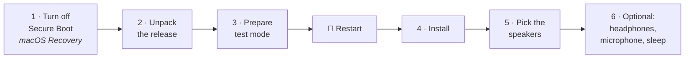

# 🚀 T2AudioPort — step-by-step install guide

For: **MacBook Pro 16" (2019), model `MacBookPro16,1`**, running Windows 10/11 x64 through Boot Camp.
Time: about 20 minutes, two restarts. You can go back to Apple's driver at any point (step 9).



> [!IMPORTANT]
> T2AudioPort is **test-signed** (there is no Microsoft signature and there will not be). Windows only loads it in **test mode**, and test mode needs **Secure Boot off**. Windows shows a small "Test Mode" text in a desktop corner while it is on. If that is not acceptable for you, stay with Apple's driver.

---

## 0. Before you start

| Check | How |
|---|---|
| ✅ It is a MacBookPro16,1 | Windows: `Win+R` → `msinfo32` → "System Model" |
| ✅ Boot Camp drivers are installed and the speakers work now | they do on a normal Boot Camp install |
| ✅ You know your macOS administrator password | needed for step 1 |
| ✅ **BitLocker:** you have the recovery key, or the installer may suspend BitLocker for one restart | `manage-bde -status C:` |
| ✅ A Windows restore point (recommended) | Start → "Create a restore point" |

## 1. Turn off Secure Boot (on the Mac, once)

1. Restart and hold **⌘ Command + R** (Windows keyboard: **Win + R**) until the Apple logo appears → **macOS Recovery**.
2. Menu **Utilities → Startup Security Utility**, sign in with your macOS administrator.
3. **Secure Boot: No Security**. Leave "External Boot" as it is.
4. Restart into Windows (hold **⌥ Option / Alt** at start-up and pick "Boot Camp" / "Windows" if needed).

## 2. Unpack the release

1. Unpack `T2AudioPort-<version>.zip` to a short path, e.g. `C:\T2AudioPort` (not inside OneDrive).
2. Open **PowerShell as Administrator** (Start → type `powershell` → right-click → *Run as administrator*) and run:

```powershell
cd C:\T2AudioPort
Get-ChildItem -Recurse | Unblock-File          # files from the internet are blocked by Windows
Set-ExecutionPolicy -Scope Process Bypass -Force  # allow the installer for this window only
```

The folder must contain `packaging\`, `tools\`, `certificate\` and `SHA256SUMS.txt`.

## 3. Prepare Windows (test mode, once)

```powershell
.\tools\T2Audio-Setup.ps1 -Action Prepare
```

What you should see:

* `✓ Secure Boot: off` — if it says **"Secure Boot is on"**, go back to step 1.
* A question **"Turn test mode on? [y/n]"** → `y`.
* If BitLocker is on: **"Suspend BitLocker for one reboot (it resumes by itself)?"** → `y` (or have the recovery key ready).
* `✓ Test mode on. Reboot Windows, then run: …`

**🔄 Restart Windows.** Afterwards "Test Mode" appears in the bottom-right corner of the desktop.

## 4. Install the driver

```powershell
cd C:\T2AudioPort
Set-ExecutionPolicy -Scope Process Bypass -Force
.\tools\T2Audio-Setup.ps1 -Action Install -Preset macos
```

1. **"Trust this test certificate on this computer (Root + TrustedPublisher)? [y/n]"** → `y` (only the first time; it is the project's public test certificate from `certificate\`).
2. Read the warning and **type `INSTALL`**.
3. Wait ~20 s (the sound may stop for a moment). Success looks like:

```
   ✓ Persistent mode on, crash guard reset.
   ✓ T2AudioPort is installed and running.
   ✓ T2 speakers: unmuted, volume 30 %, L/R balance evened (…)
```

## 5. Pick the speakers

Windows usually switches by itself. If not: taskbar sound icon → **›** next to the volume → choose **Speakers (Apple T2 Audio Device …)**. Play some music. 🎶

Check everything at any time:

```powershell
.\tools\T2Audio-Setup.ps1 -Action Status
```

`Crash guard: OK`, `Persistent mode: on`, preset `Like macOS (recommended)`.

## 6. Optional: headphones, microphone, sound after sleep

```powershell
.\tools\T2Audio-Setup.ps1 -Action Features -Headphones 1 -Microphone 1 -ResumeAfterSleep 1
```

| Feature | What you get | Good to know |
|---|---|---|
| 🎧 `-Headphones 1` | A second output **"Headphones (Apple T2 Audio Device …)"** | **Switching is manual for now**: when you plug headphones in, pick "Headphones" in the sound menu, and "Speakers" again when you unplug. Starts 12 dB quieter for safety. |
| 🎙️ `-Microphone 1` | **"Microphone Array (Apple T2 Audio Device …)"** | Mono, no noise suppression. Test it in the Voice Recorder app. |
| 🌙 `-ResumeAfterSleep 1` | Music continues after the lid is opened | |
| 🎛️ `-ExtraFormats 1` | 16/24-bit in Sound settings → Advanced | Only for apps that use exclusive mode |

Turn any of them off with `0`. Or use the menu: `.\tools\T2Audio-Setup.ps1` → item **6**.

## 7. Make it sound the way you like

```powershell
.\tools\T2Audio-Setup.ps1 -Action Preset -Preset bright      # or loud, even, voice, movie, night …
.\tools\T2Audio-Setup.ps1 -Action Tune -BassDb 2 -TrebleDb 1 # small tweaks on top
.\tools\T2Audio-Setup.ps1 -Action Preset -Preset macos       # back to the default
```

All presets: [INSTALL.md → Presets](INSTALL.md#presets). `macos` is the one tuned and approved by ear; `bass` can rattle on kick drums at high volume.

## 8. Keeping it working

* **After a big Windows update** check `-Action Status`. If it says the device runs **AppleAudio** again, run `-Action Install` once more.
* To stop Windows Update from doing that: `-Action UpdateGuard -Block 1` (it stops driver updates for **all** devices; `-Block 0` undoes it).
* **No sound after a crash?** After two unclean ends in a row the driver steps aside on purpose. `-Action Status` shows it; `-Action ResetGuard` lets it load again.

## 9. Going back to Apple's driver

```powershell
.\tools\T2Audio-Setup.ps1 -Action Uninstall
```

* Confirms, removes T2AudioPort, and the device returns to **AppleAudio**.
* Then it offers to **turn test mode off** — say `y` if you do not need test mode for anything else, and restart.
* Afterwards you can set **Secure Boot** back to "Full Security" in the Startup Security Utility (step 1, reversed).

If AppleAudio does not come back by itself: restart, or run `.\tools\Restore-AppleAudioDriver.ps1` (downloads the Boot Camp driver).

## 🆘 Troubleshooting

| Problem | Fix |
|---|---|
| "running scripts is disabled on this system" | `Set-ExecutionPolicy -Scope Process Bypass -Force` in the same window (step 2) |
| "Run PowerShell as administrator." | Open PowerShell with *Run as administrator* |
| "Secure Boot is on" | Step 1 |
| "testsigning is off" during install | Step 3 and restart |
| "The device did not start" / Code 52 | Test mode off or certificate not trusted: `-Action Prepare`, restart, install again |
| One side quieter | `-Action Balance -Volume 0.3` |
| Headphones silent | Choose "Headphones" as the output (no automatic switching yet) |
| Microphone silent | `-Action Features -Microphone 1`, then pick "Microphone Array" as the input |
| BitLocker asks for the recovery key | Enter it once (`aka.ms/myrecoverykey` if it is in your Microsoft account) |
| Anything else | `-Action Uninstall` returns Apple's driver; open an issue with the output of `-Action Status` |

## ❓ FAQ

**Is test mode dangerous?** It lets Windows load drivers signed with test certificates, which normal Windows refuses. It does not turn anything else off, but it does lower one protection layer. Turn it off again when you uninstall.

**Does it touch macOS?** No. Only Windows and the Secure Boot setting of the Mac (step 1) change.

**Why not just Boot Camp?** Apple's driver has its own, simpler speaker processing and no settings. T2AudioPort uses the KAIT2EN profile (built to sound like macOS), with presets and tone controls, and keeps working through sleep and reboots. A side-by-side comparison with Boot Camp and macOS is still planned — judge with your own ears; `-Action Uninstall` takes you back.

**Other Macs?** Not yet. Do not install on another model: the speaker layout and limits differ.
