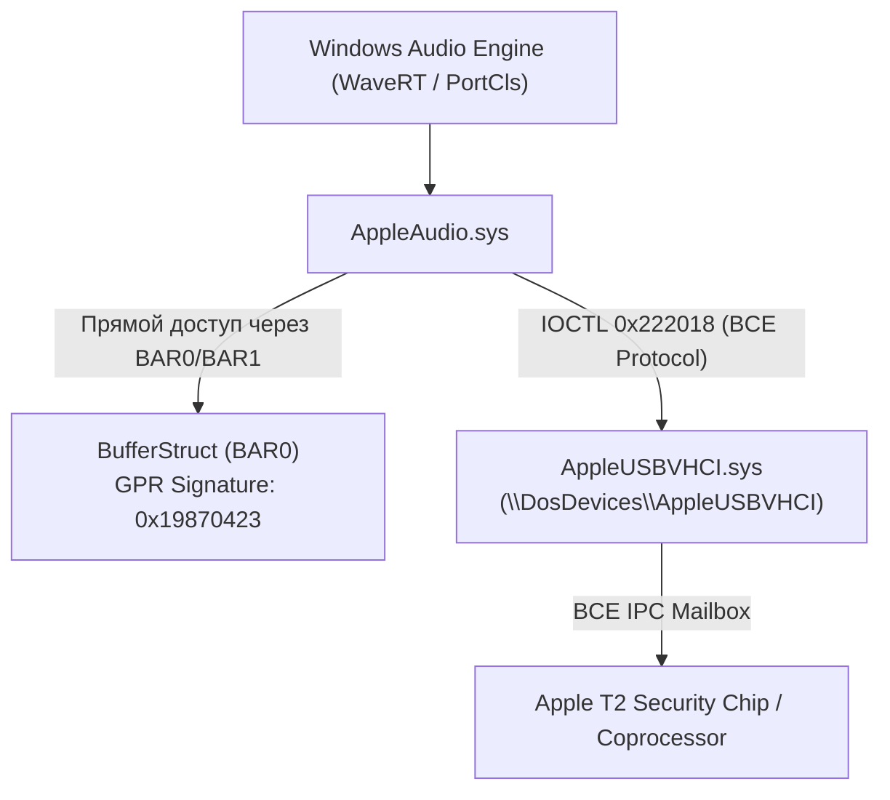

# Полный отчет реверс-инжиниринга драйвера AppleAudio.sys

## 1. Введение и методология

Анализ официального драйвера звука **AppleAudio.sys** (`cd8b81fabc9be6127a082da22c4cc046a4d46e0225eb6baf6d27e0dc9862a150`, 122 752 байт) был выполнен с помощью фреймворка **REA (Reverse Engineer Anything)** и декомпилятора **Ghidra 12.1.4**.

В ходе сессии были обнаружены ключевые функции управления потоками, выделения памяти и взаимодействия с транспортом `AppleUSBVHCI.sys`.

---

## 2. Ключевая архитектура драйвера



---

## 3. Транспорт команд: `FUN_140004a4c`

Все 31 процедура драйвера (чтение свойств, настройка формата, громкость, start/stop потока) отправляют команды через единую функцию-шлюз `FUN_140004a4c`:

```c
uint FUN_140004a4c(undefined8 param_1, uint *param_2, undefined4 param_3, 
                  undefined8 param_4, undefined4 param_5)
{
    uint uVar1;
    longlong lVar2;
    PDEVICE_OBJECT DeviceObject = NULL;
    PFILE_OBJECT FileObject = NULL;
    UNICODE_STRING DeviceName;
    IO_STATUS_BLOCK Iosb;
    KEVENT Event;
    
    // Инициализация имени \DosDevices\AppleUSBVHCI
    uVar1 = InitUnicodeString(&DeviceName, L"\\DosDevices\\AppleUSBVHCI");
    if (uVar1 >= 0) {
        uVar1 = IoGetDeviceObjectPointer(&DeviceName, FILE_READ_DATA, &FileObject, &DeviceObject);
        if (uVar1 >= 0) {
            // Генерация тега запроса (циклический счетчик 1..127):
            *param_2 = (*param_2 % 0x7f) + 1;
            
            KeInitializeEvent(&Event, NotificationEvent, FALSE);
            
            // Внимание: IOCTL 0x222018!
            lVar2 = IoBuildDeviceIoControlRequest(
                0x222018, DeviceObject,
                param_2, param_3,  // InputBuffer, InputLength
                param_4, param_5,  // OutputBuffer, OutputLength
                FALSE, &Event, &Iosb
            );
            
            if (lVar2 == 0) {
                uVar1 = STATUS_UNSUCCESSFUL;
            } else {
                uVar1 = IofCallDriver(DeviceObject, lVar2);
                if (uVar1 == STATUS_PENDING) {
                    KeWaitForSingleObject(&Event, Executive, KernelMode, FALSE, NULL);
                    uVar1 = Iosb.Status;
                }
            }
        }
    }
    if (FileObject != NULL) {
        ObfDereferenceObject(FileObject);
    }
    return uVar1;
}
```

### Формат сообщения BCE:
Заголовок и тело пакета точно соответствуют спецификации BCE Audio Protocol:
1. `tag`: 4 байта (`1..0x7F`)
2. `type`: 1 байт (`1 = COMMAND`, `2 = RESPONSE`, `3 = NOTIFICATION`)
3. `device_id`: 8 байт (`uint64_t`)
4. `msg`: 4 байта (`0 = START_IO`, `2 = STOP_IO`, `26 = GET_OUTPUT_STREAM_LIST`, etc.)
5. `status`: 4 байта (`0 = STATUS_SUCCESS`)
6. `payload`: специфичные данные команды.

---

## 4. Управление воспроизведением: Start & Stop

### 4.1 Запуск потока (`FUN_1400048b0`)
```c
uint FUN_1400048b0(uint *seq_tag_ptr, longlong *dev_ctx)
{
    uint status;
    uint tag = *seq_tag_ptr;
    *seq_tag_ptr = tag + 1;
    
    // Сброс временных меток и позиций
    FUN_1400023a0(seq_tag_ptr, *dev_ctx);
    
    // Формирование START_IO (msg = 0, type = 1, len = 21 байт)
    msg_buf.tag = tag;
    msg_buf.type = 1;         // T2AUDIO_MSG_TYPE_COMMAND
    msg_buf.device_id = *dev_ctx;
    msg_buf.msg = 0;          // T2AUDIO_MSG_START_IO
    msg_buf.status = 0;
    
    status = FUN_140004a4c(seq_tag_ptr, &msg_buf, 0x15, resp_buf, 0x15);
    if (status >= 0) {
        // Проверка ответа: msg == 1 (START_IO_RESPONSE) и status == 0
        if (resp_buf.msg == 1 && resp_buf.status == 0) {
            *(uint8_t *)(dev_ctx + 0x1d2a) = 1; // is_started = 1 (offset 0xE950)
        } else {
            status = STATUS_UNSUCCESSFUL;
        }
    }
    return status;
}
```

### 4.2 Остановка потока (`FUN_140004970`)
```c
uint FUN_140004970(uint *seq_tag_ptr, longlong *dev_ctx)
{
    // Формирование STOP_IO (msg = 2, type = 1, len = 21 байт)
    msg_buf.msg = 2; // T2AUDIO_MSG_STOP_IO
    status = FUN_140004a4c(seq_tag_ptr, &msg_buf, 0x15, resp_buf, 0x15);
    if (status >= 0 && resp_buf.msg == 3 && resp_buf.status == 0) {
        *(uint8_t *)(dev_ctx + 0x1d2a) = 0; // is_started = 0
    }
    FUN_1400023a0(seq_tag_ptr, *dev_ctx);
    return status;
}
```

---

## 5. Выделение памяти и регистрация в BufferStruct (`FUN_140001fa4`)

В отличие от стандартных PCI аудиодрайверов, где DMA настраивается через контроллер шины, в архитектуре Apple T2:

1. **Выделение физпамяти:**
   ```c
   MDL = MmAllocatePagesForMdl(0x2000, 0x1fffffffff, 0, PageAlignedBytes);
   SystemVA = MmMapLockedPagesSpecifyCache(MDL, KernelMode, MmCached, NULL, FALSE, 0x40000020);
   ```
2. **Построение дескриптора непрерывных физических диапазонов:**
   - Каждая запись — 24 байта:
     - `+0x00`: указатель на следующий элемент списка (или 0).
     - `+0x08`: физический адрес `(PFN << 12)`.
     - `+0x10`: размер непрерывного диапазона в байтах.
3. **Регистрация в BufferStruct (`FUN_1400046f8`):**
   - Драйвер проверяет сигнатуру GPR в BAR2/BAR4: `GPR[0x04] == 0x19870423`.
   - Находит базовый смещение `BufferStruct` из `GPR[0x08]` в BAR0/BAR1.
   - Записывает имя устройства (до 128 байт) и цепочку физических адресов буферов непосредственно в память `BufferStruct`.
4. Сохраняет адреса в контексте устройства:
   - `stream[0x164]`: виртуальный адрес `SystemVA` (для `MmUnmapLockedPages`).
   - `stream[0x165]`: указатель на `MDL` (для `MmFreePagesFromMdl`).
   - `stream[0x166]`: указатель на дескриптор физпамяти (тег `'CCAA'`).

---

## 6. Причина падения в BSOD 0x7E в `T2AudioPort`

> [!CRITICAL]
> **Причина падения устранена теоретически и подтверждена дизассемблером:**
> - `AppleAudio.sys` передает команды T2 чипу **исключительно через IOCTL `0x222018`**!
> - Драйвер `AppleUSBVHCI.sys` обрабатывает `0x222018` внутри своего стека сообщений без обращения к KS / KSTHUNK.
> - Напротив, дескрипторные IOCTL (`0x222008`, `0x22200C`) в `AppleUSBVHCI` предназначены для внутренних дескрипторов и при определенных путях пересылают IRP в `ksthunk!DispatchDeviceIoControl`, где отсутствие `FileObject` вызывает немедленный разыменование NULL (`BSOD 0x7E`).
> - Для безопасной работы открытого драйвера `T2AudioPort` весь обмен сообщениями BCE должен быть переведен на доказанный IOCTL `0x222018`.
