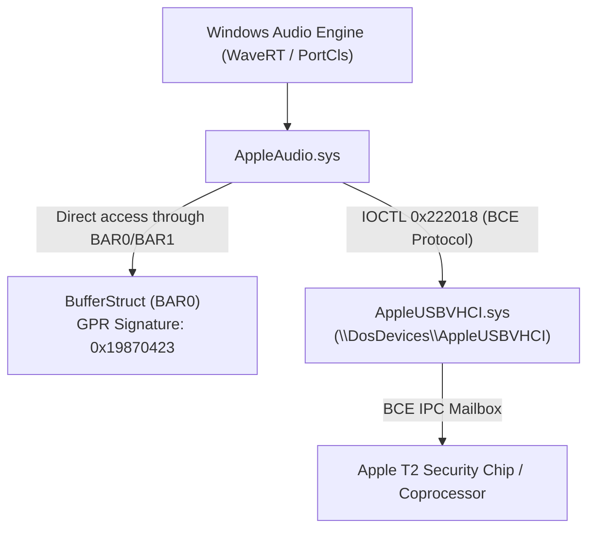

# Full reverse-engineering report of the AppleAudio.sys driver

> **Status note (2026-10-28):** §6 was the first, wrong explanation of BSOD 0x7E. The real cause is the `IOCTL 0x222020` that AppleUSBVHCI sends to the audio driver; see `START_IO_BSOD_ROOT_CAUSE.md` and `RE_minidump.md`.

## 1. Introduction and method

The official sound driver **AppleAudio.sys** (`cd8b81fabc9be6127a082da22c4cc046a4d46e0225eb6baf6d27e0dc9862a150`, 122 752 bytes) was analysed with the **REA (Reverse Engineer Anything)** framework and the **Ghidra 12.1.4** decompiler.

The session found the key functions for stream control, memory allocation and talking to the `AppleUSBVHCI.sys` transport.

---

## 2. Key driver architecture



---

## 3. Command transport: `FUN_140004a4c`

All 31 routines of the driver (reading properties, format setup, volume, stream start/stop) send their commands through a single gateway function `FUN_140004a4c`:

```c
uint FUN_140004a4c(undefined8 param_1, uint *param_2, undefined4 param_3, 
                  undefined8 param_4, undefined4 param_5)
{
    uint uVar1;
    longlong lVar2;
    PDEVICE_OBJECT DeviceObject = NULL;
    PFILE_OBJECT FileObject = NULL;
    UNICODE_STRING DeviceName;
    IO_STATUS_BLOCK Iosb;
    KEVENT Event;
    
    // Initialise the name \DosDevices\AppleUSBVHCI
    uVar1 = InitUnicodeString(&DeviceName, L"\\DosDevices\\AppleUSBVHCI");
    if (uVar1 >= 0) {
        uVar1 = IoGetDeviceObjectPointer(&DeviceName, FILE_READ_DATA, &FileObject, &DeviceObject);
        if (uVar1 >= 0) {
            // Request tag (cyclic counter 1..127):
            *param_2 = (*param_2 % 0x7f) + 1;
            
            KeInitializeEvent(&Event, NotificationEvent, FALSE);
            
            // Note: IOCTL 0x222018!
            lVar2 = IoBuildDeviceIoControlRequest(
                0x222018, DeviceObject,
                param_2, param_3,  // InputBuffer, InputLength
                param_4, param_5,  // OutputBuffer, OutputLength
                FALSE, &Event, &Iosb
            );
            
            if (lVar2 == 0) {
                uVar1 = STATUS_UNSUCCESSFUL;
            } else {
                uVar1 = IofCallDriver(DeviceObject, lVar2);
                if (uVar1 == STATUS_PENDING) {
                    KeWaitForSingleObject(&Event, Executive, KernelMode, FALSE, NULL);
                    uVar1 = Iosb.Status;
                }
            }
        }
    }
    if (FileObject != NULL) {
        ObfDereferenceObject(FileObject);
    }
    return uVar1;
}
```

### BCE message format:
The packet header and body match the BCE Audio Protocol spec exactly:
1. `tag`: 4 bytes (`1..0x7F`)
2. `type`: 1 byte (`1 = COMMAND`, `2 = RESPONSE`, `3 = NOTIFICATION`)
3. `device_id`: 8 bytes (`uint64_t`)
4. `msg`: 4 bytes (`0 = START_IO`, `2 = STOP_IO`, `26 = GET_OUTPUT_STREAM_LIST`, etc.)
5. `status`: 4 bytes (`0 = STATUS_SUCCESS`)
6. `payload`: command-specific data.

---

## 4. Playback control: Start & Stop

### 4.1 Stream start (`FUN_1400048b0`)
```c
uint FUN_1400048b0(uint *seq_tag_ptr, longlong *dev_ctx)
{
    uint status;
    uint tag = *seq_tag_ptr;
    *seq_tag_ptr = tag + 1;
    
    // Reset timestamps and positions
    FUN_1400023a0(seq_tag_ptr, *dev_ctx);
    
    // Build START_IO (msg = 0, type = 1, len = 21 bytes)
    msg_buf.tag = tag;
    msg_buf.type = 1;         // T2AUDIO_MSG_TYPE_COMMAND
    msg_buf.device_id = *dev_ctx;
    msg_buf.msg = 0;          // T2AUDIO_MSG_START_IO
    msg_buf.status = 0;
    
    status = FUN_140004a4c(seq_tag_ptr, &msg_buf, 0x15, resp_buf, 0x15);
    if (status >= 0) {
        // Check the reply: msg == 1 (START_IO_RESPONSE) and status == 0
        if (resp_buf.msg == 1 && resp_buf.status == 0) {
            *(uint8_t *)(dev_ctx + 0x1d2a) = 1; // is_started = 1 (offset 0xE950)
        } else {
            status = STATUS_UNSUCCESSFUL;
        }
    }
    return status;
}
```

### 4.2 Stream stop (`FUN_140004970`)
```c
uint FUN_140004970(uint *seq_tag_ptr, longlong *dev_ctx)
{
    // Build STOP_IO (msg = 2, type = 1, len = 21 bytes)
    msg_buf.msg = 2; // T2AUDIO_MSG_STOP_IO
    status = FUN_140004a4c(seq_tag_ptr, &msg_buf, 0x15, resp_buf, 0x15);
    if (status >= 0 && resp_buf.msg == 3 && resp_buf.status == 0) {
        *(uint8_t *)(dev_ctx + 0x1d2a) = 0; // is_started = 0
    }
    FUN_1400023a0(seq_tag_ptr, *dev_ctx);
    return status;
}
```

---

## 5. Memory allocation and registration in BufferStruct (`FUN_140001fa4`)

Unlike standard PCI audio drivers, where DMA is set up through the bus controller, in the Apple T2 architecture:

1. **Physical memory allocation:**
   ```c
   MDL = MmAllocatePagesForMdl(0x2000, 0x1fffffffff, 0, PageAlignedBytes);
   SystemVA = MmMapLockedPagesSpecifyCache(MDL, KernelMode, MmCached, NULL, FALSE, 0x40000020);
   ```
2. **Building the descriptor of contiguous physical ranges:**
   - Each entry is 24 bytes:
     - `+0x00`: pointer to the next list element (or 0).
     - `+0x08`: physical address `(PFN << 12)`.
     - `+0x10`: size of the contiguous range in bytes.
3. **Registration in BufferStruct (`FUN_1400046f8`):**
   - The driver checks the GPR signature in BAR2/BAR4: `GPR[0x04] == 0x19870423`.
   - Finds the `BufferStruct` base offset from `GPR[0x08]` in BAR0/BAR1.
   - Writes the device name (up to 128 bytes) and the chain of physical buffer addresses directly into `BufferStruct` memory. (Later analysis: this path is used for **input** streams, i.e. microphones; the speaker output uses the ring the T2 provides.)
4. Stores the addresses in the device context:
   - `stream[0x164]`: the virtual address `SystemVA` (for `MmUnmapLockedPages`).
   - `stream[0x165]`: pointer to the `MDL` (for `MmFreePagesFromMdl`).
   - `stream[0x166]`: pointer to the physical memory descriptor (tag `'CCAA'`).

---

## 6. Cause of BSOD 0x7E in `T2AudioPort` (first hypothesis, superseded)

> [!CRITICAL]
> **The cause of the crash was considered fixed in theory and confirmed by the disassembler** (later disproved, see the note at the top):
> - `AppleAudio.sys` sends commands to the T2 chip **only through IOCTL `0x222018`**!
> - `AppleUSBVHCI.sys` handles `0x222018` inside its own message stack without touching KS / KSTHUNK.
> - By contrast, the descriptor IOCTLs (`0x222008`, `0x22200C`) in `AppleUSBVHCI` are meant for internal descriptors and on certain paths forward the IRP to `ksthunk!DispatchDeviceIoControl`, where the missing `FileObject` causes an immediate NULL dereference (`BSOD 0x7E`).
> - For the open `T2AudioPort` driver to work safely, all BCE messaging must use the proven IOCTL `0x222018`.
